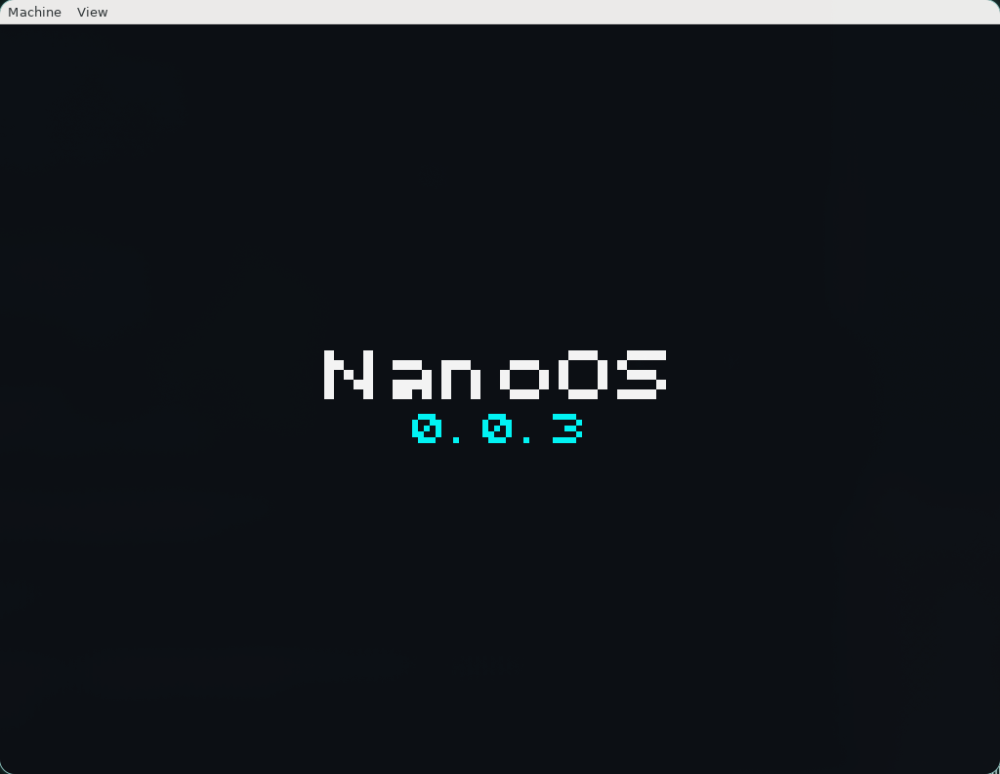

# NanoOS

**A hobby operating system project written in C for the x86_64 architecture.**

[](https://en.wikipedia.org/wiki/X86-64)
[](https://en.wikipedia.org/wiki/C_(programming_language))
[](LICENSE)
[](https://github.com/friedrichOsDev/NanoOS)

NanoOS is an experimental operating system development project focused on building a modular x86_64 kernel from the ground up.

The project explores low-level systems programming, hardware interaction, memory management, multitasking, interrupt handling, and graphical output.

It is developed as a personal project to explore operating system internals and gain practical experience with systems programming.

> **Development status:** NanoOS is still under active development. Features and interfaces may change, and the project is not intended for daily use.

---

## Contents

- [Overview](#overview)
- [Features](#features)
- [Architecture](#architecture)
- [Project Structure](#project-structure)
- [Requirements](#requirements)
- [Getting Started](#getting-started)
- [Building](#building)
- [Running with QEMU](#running-with-qemu)
- [Debugging](#debugging)
- [Documentation](#documentation)
- [Development Guidelines](#development-guidelines)
- [Testing](#testing)
- [Roadmap](#roadmap)
- [Contributing](#contributing)
- [Third-Party Components](#third-party-components)
- [License](#license)

---

## Overview

NanoOS uses a modular kernel architecture with a separation between architecture-specific implementations, generic kernel components, hardware drivers, and shared libraries.

The current implementation targets x86_64 systems and uses GRUB with the Multiboot2 protocol for kernel loading.

The kernel is built as a freestanding executable using a custom `x86_64-elf` cross-compilation toolchain.

### Technical Overview

| Component | Implementation |
|---|---|
| Architecture | x86_64 |
| Kernel language | C (C23) |
| Assembly | NASM / GNU Assembly |
| Bootloader | GRUB |
| Boot protocol | Multiboot2 |
| Firmware | UEFI |
| Compiler | x86_64-elf-gcc |
| Linker | x86_64-elf-ld |
| Build system | GNU Make |
| Virtualization | QEMU |
| Firmware emulation | OVMF |
| Development environment | Docker / VS Code Dev Containers |
| Documentation | Doxygen |

---

## Features

The following components are currently implemented in the codebase. Their individual maturity and hardware compatibility may vary.

### Kernel and Architecture

- 64-bit x86 kernel.
- GRUB Multiboot2 boot support.
- UEFI boot environment.
- Global Descriptor Table (GDT).
- Interrupt Descriptor Table (IDT).
- Interrupt and exception handling.
- Interrupt Request (IRQ) handling.
- Floating-point unit and SSE initialization.
- Low-level CPU and hardware interfaces.

### Memory Management

- Physical Memory Manager (PMM).
- Bitmap-based physical page allocation.
- Virtual Memory Manager (VMM).
- Four-level x86_64 paging.
- Virtual address space management.
- Memory mapping and MMIO support.
- Kernel heap allocator.
- Dynamic kernel memory allocation and deallocation.

### Multitasking and Multiprocessing

- Preemptive round-robin scheduler.
- Kernel thread management.
- Process management structures.
- Context switching.
- Per-CPU state management.
- Symmetric Multiprocessing (SMP) initialization.
- Multi-core scheduling support.
- Synchronization primitives, including spinlocks and mutexes.

### Hardware and Platform Support

- ACPI table parsing.
- ACPI power management.
- ACPI-based system shutdown.
- Advanced Programmable Interrupt Controller (APIC).
- Local APIC and I/O APIC support.
- HPET timer support.
- Real-Time Clock (RTC).
- PCI device enumeration.
- Serial communication and logging.

### Input Subsystem

- Hardware-independent HID interface.
- Event-based input handling.
- Input event ring buffer.
- PS/2 controller support using the i8042 controller.
- PS/2 keyboard and mouse drivers.
- Set 2 keyboard scan-code parsing.
- ISO 105-key keyboard support.
- Keyboard layout translation, including German layouts.

### Graphics

- Multiboot2 framebuffer support.
- Framebuffer video driver.
- Video driver abstraction layer.
- Software-based 2D compositor.
- Layer-based rendering.
- Backbuffer rendering.
- Kernel version splash screen.

---

## Architecture

NanoOS follows a modular architecture designed to separate hardware-specific functionality from general kernel components.

### Kernel Layers

| Directory | Responsibility |
|---|---|
| `arch/x86_64/` | Architecture-specific code and hardware initialization |
| `core/` | Kernel initialization and core functionality |
| `drivers/` | General kernel drivers and hardware abstractions |
| `include/` | Shared kernel interfaces and public headers |
| `lib/` | Internal utility libraries and mathematical functions |
| `sched/` | Processes, threads, and scheduling |

Architecture-dependent implementations are kept separate from general kernel interfaces whenever possible.

For example, the memory management implementation is located under `arch/x86_64/mm/`, while its shared interface is exposed through `include/mm/`.

### Memory Management Overview

The memory management subsystem consists of three main components:

1. **Physical Memory Manager (PMM)**  
   Manages physical memory pages using a bitmap-based allocation mechanism.

2. **Virtual Memory Manager (VMM)**  
   Manages page tables, virtual address spaces, and memory mappings using x86_64 paging.

3. **Kernel Heap**  
   Provides dynamic memory allocation for kernel components.

### Boot Process

NanoOS uses GRUB and Multiboot2 to load the kernel in a UEFI environment.

The general boot sequence is:

1. UEFI initializes the platform.
2. GRUB loads the NanoOS kernel.
3. GRUB transfers boot information using Multiboot2.
4. The kernel initializes its CPU structures and interrupt handling.
5. Physical and virtual memory management are initialized.
6. ACPI, APIC, timers, and PCI are initialized.
7. The scheduler and SMP subsystem are initialized.
8. Kernel threads are started and normal kernel execution begins.

---

## Project Structure

```text
NanoOS/
├── .devcontainer/       # VS Code development container configuration
├── .github/
│   └── workflows/      # GitHub Actions workflows
├── .vscode/             # VS Code tasks and settings
├── grub/                # GRUB configuration
├── scripts/
│   ├── docker/          # Container-related scripts
│   ├── linux/           # Linux development scripts
│   └── mac/             # macOS development scripts
├── src/
│   └── kernel/
│       ├── arch/
│       │   └── x86_64/  # x86_64-specific implementations
│       │       ├── acpi/
│       │       ├── apic/
│       │       ├── boot/
│       │       ├── drivers/
│       │       ├── fpu/
│       │       ├── gdt/
│       │       ├── idt/
│       │       ├── mm/
│       │       └── smp/
│       ├── core/        # Kernel core
│       ├── drivers/     # General drivers
│       │   ├── gfx/
│       │   └── hid/
│       ├── include/     # Shared header files
│       ├── lib/         # Utility libraries
│       └── sched/       # Scheduling and multitasking
├── uefi/                # OVMF firmware images
├── Doxyfile             # Doxygen configuration
├── Makefile             # Kernel build system
└── README.md
```

---

## Requirements

NanoOS uses a Docker-based development environment to provide a reproducible cross-compilation toolchain.

### Host Requirements

- Git
- Docker Engine or Docker Desktop
- Visual Studio Code
- Visual Studio Code Dev Containers extension

### Development Container

The development container provides the required build and debugging tools.

| Tool | Purpose |
|---|---|
| GCC 14.2.0 | x86_64 cross-compiler |
| GNU Binutils 2.45 | Cross-compiler linker and binary utilities |
| NASM | Assembly compilation |
| GNU Make | Build automation |
| QEMU | Virtual machine |
| OVMF | UEFI firmware emulation |
| GRUB utilities | Bootable ISO generation |
| GDB | Kernel debugging |
| Bear | Compilation database generation |
| clangd | C/C++ language server |
| clang-format | Code formatting |
| Doxygen | API documentation |
| Graphviz | Documentation diagrams |

The container is based on Ubuntu 24.04.

---

## Getting Started

### 1. Clone the Repository

```bash
git clone https://github.com/friedrichOsDev/NanoOS.git

cd NanoOS
```

### 2. Build the Development Container

NanoOS provides separate scripts for building the development container on Linux and macOS.

**Linux:**

```bash
./scripts/linux/build_docker.sh
```

**macOS:**

```bash
./scripts/mac/build_docker.sh
```

These scripts build the Docker image named `nano-cross`, which is used by the VS Code development container.

### 3. Open the Project in VS Code

Open the repository:

```bash
code .
```

Make sure the VS Code Dev Containers extension is installed.

Then execute:

```text
Dev Containers: Reopen in Container
```

VS Code will use the existing `nano-cross` image.

After the container has started, the cross-compiler and development tools should be available.

---

## Building

NanoOS uses GNU Make for compiling the kernel and generating bootable ISO images.

All commands below are intended to be executed inside the development container.

### Release Build

Build the release kernel:

```bash
make release
```

Generate a bootable ISO:

```bash
make iso
```

Alternatively, the default target builds the ISO:

```bash
make
```

### Debug Build

Build the debug kernel:

```bash
make debug
```

Generate a debug ISO:

```bash
make iso-debug
```

### Build Artifacts

Generated files are placed in the `build/` directory.

| File | Description |
|---|---|
| `build/kernel.elf` | Release kernel executable |
| `build/kernel.debug` | Debug kernel executable |
| `build/nanoos.iso` | Release bootable ISO |
| `build/nanoos-debug.iso` | Debug bootable ISO |

### Clean Build Artifacts

Remove generated build files and ISO contents:

```bash
make clean
```

---

## Running with QEMU

NanoOS is primarily developed and tested using QEMU with OVMF UEFI firmware.

Before the first run, create a writable copy of the OVMF variable store:

```bash
cp uefi/OVMF_VARS.4m.fd uefi/my_OVMF_VARS.4m.fd
```

The writable copy is intentionally excluded from Git.

### Release Environment

Build and start NanoOS:

```bash
make run
```

### Debug Environment

Build and start the debug version:

```bash
make run-debug
```

### Default QEMU Configuration

The Makefile currently uses the following virtual hardware configuration:

| Setting | Value |
|---|---|
| Machine | Q35 |
| CPU cores | 4 |
| Memory | 8 GiB |
| Graphics | VirtIO VGA |
| Firmware | OVMF UEFI |
| Boot device | NanoOS ISO |
| Serial output | Captured in `serial.log` |

QEMU diagnostic information is written to `qemu.log`.



## Debugging

NanoOS includes support for debugging with GDB.

A dedicated debug session can be started using:

```bash
make debug-session
```

This target starts QEMU with its GDB debugging interface enabled and launches GDB with the debug kernel.

The kernel is initially paused to allow debugging before execution begins.

Alternatively, GDB can be started separately:

```bash
make gdb
```

The separate GDB target expects a QEMU instance with its GDB server listening on the default port.

---

### Compilation Database

Generate a compilation database for clangd:

```bash
make compile-commands
```

This uses Bear to generate `compile_commands.json`.

---

## Documentation

NanoOS uses Doxygen for source-code documentation.

The documentation includes source references, function descriptions, dependencies, and generated diagrams.

### Generate Documentation Locally

```bash
doxygen Doxyfile
```

The generated HTML documentation is placed in:

```text
docs/html/
```

### Online Documentation

The latest published documentation is available at:

**[NanoOS Documentation](https://friedrichOsDev.github.io/NanoOS/)**

GitHub Actions automatically generates and deploys the Doxygen documentation when changes are pushed to the `x86_64-main` branch.

---

## Development Guidelines

The project follows a consistent coding style to keep the codebase maintainable.

### Code Formatting

The repository includes a `.clang-format` configuration.

The main formatting conventions are:

- LLVM-based formatting.
- Four spaces for indentation.
- No tabs.
- No enforced maximum line length.

### Documentation

C and header files should include a Doxygen file header:

```c
/**
 * @file filename.c
 * @brief Short description of the file.
 * @author friedrichOsDev
 */
```

Public functions and important internal components should also have meaningful Doxygen descriptions.

### General Guidelines

- Keep architecture-specific code separate from generic kernel functionality.
- Prefer clearly defined interfaces between subsystems.
- Avoid unnecessary dependencies between independent modules.
- Use descriptive function and variable names.
- Handle errors explicitly.
- Avoid introducing compiler warnings.
- Preserve original license and copyright notices in third-party code.

---

## Testing

Testing is primarily performed through QEMU and manual verification of kernel functionality.

Static analysis is available through:

```bash
make analyze
```

---

## Roadmap

NanoOS is actively evolving. The following section tracks planned development work.

- [ ] Kernel Shell for simple interaction
- [ ] Storage Device drivers for IDE and AHCI
- [ ] File system drivers for FAT32 and some other file systems
- [ ] USB driver for USB Mass Storage Devices
- [ ] Networking driver (Ethernet)
- [ ] Init user process similar to systemd but simpler
- [ ] Syscalls
- [ ] Userland
- [ ] Binary program starter / loader
- [ ] Nvidia Driver (linux kernel module with linux compat layer)

---

## Contributing

NanoOS is primarily a personal operating system development project.

Suggestions, bug reports, and technical discussions are welcome.

### Reporting Issues
When reporting an issue, please include:

- A clear description of the problem.
- Steps to reproduce the issue.
- Relevant serial output or QEMU logs.
- The environment in which the problem occurred.

### Branch Naming Conventions
If you are contributing code or working on a new change, please use meaningful prefixes for your branch names followed by a short, descriptive title (using lowercase and hyphens):

- **`feature/`** – For adding new features or components (e.g., `feature/virtio-net-driver`)
- **`fix/`** – For bug fixes and patches (e.g., `fix/page-fault-handler`)
- **`refactor/`** – For code restructuring and cleanups without changing behavior (e.g., `refactor/scheduler-loops`)
- **`docs/`** – For documentation updates and improvements (e.g., `docs/update-building-guide`)

### Pull Request Guidelines
- Ensure your code compiles without warnings in the target build environment.
- Format your code according to the project's style guidelines.
- Provide a clear summary of the changes and the reasoning behind them in the pull request description.


---

## Third-Party Components

NanoOS incorporates third-party code in selected areas.

A large part of the mathematical library is based on the FreeBSD libm library.

Original copyright notices and applicable license conditions are retained in the corresponding source files.

Please refer to individual source-file headers for additional licensing information.

---

## License

NanoOS is distributed under the MIT License.

See the [LICENSE](LICENSE) file for details.

Third-party components may be subject to their own license terms.

---

## Author

**Friedrich — friedrichOsDev**

German student interested in computer science, systems programming, and operating system development.

- GitHub: [@friedrichOsDev](https://github.com/friedrichOsDev)
- Project: [NanoOS](https://github.com/friedrichOsDev/NanoOS)
